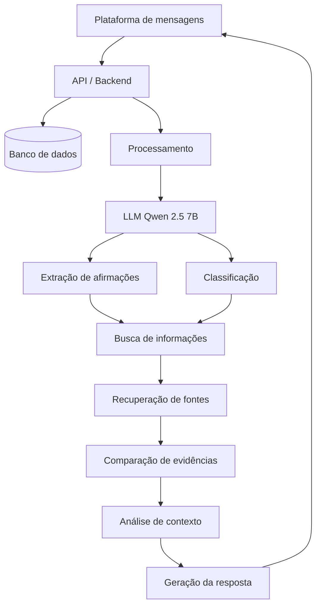
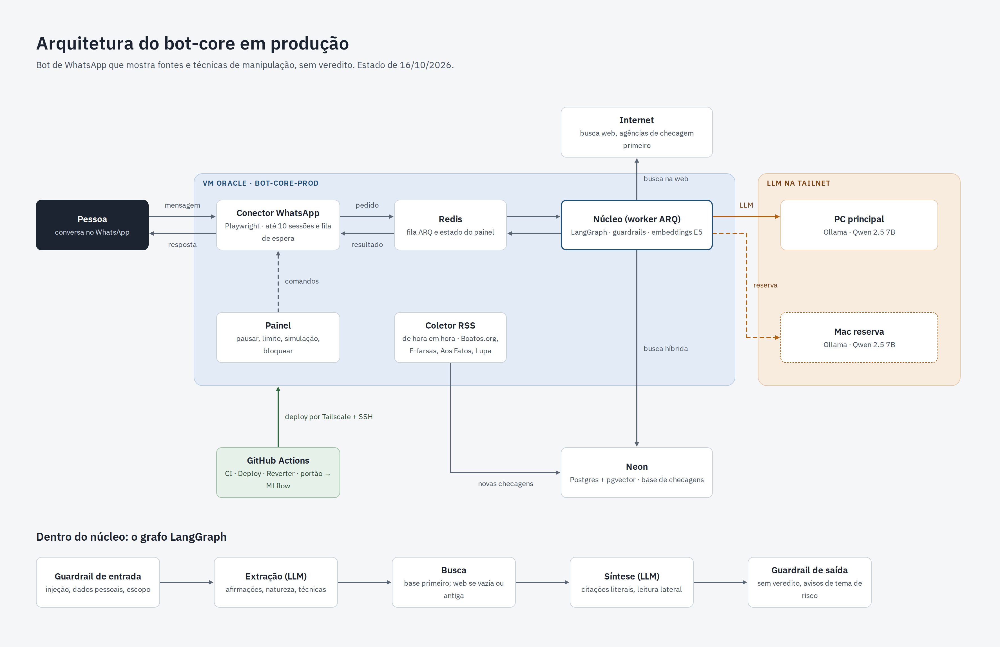
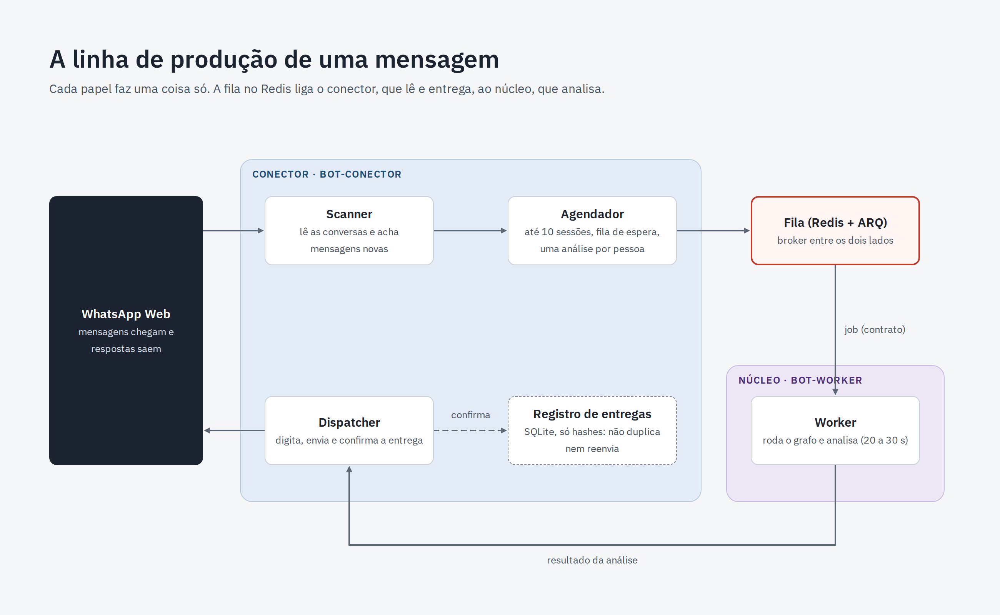
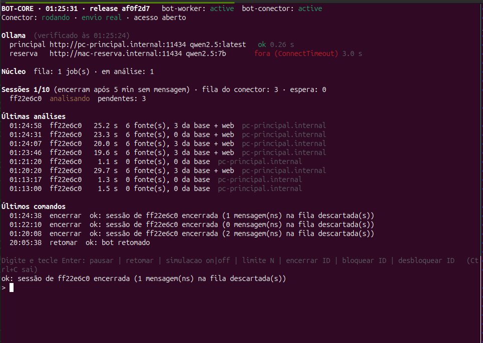
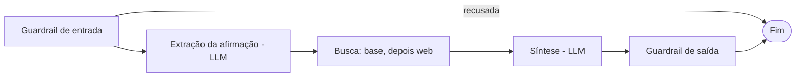
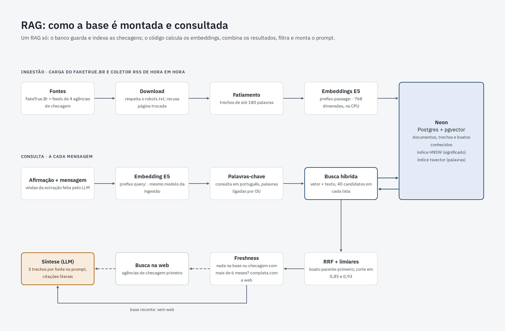

# Arquitetura

## Escopo do MVP

O MVP deve ser suficientemente pequeno para permitir uma implementação e avaliação realistas.

### Entradas aceitas

- texto;
- links.

Exemplos:

> "O governo vai proibir determinado produto amanhã."
>
> `https://exemplo.com/noticia`

O sistema deve ser capaz de analisar tanto uma afirmação digitada diretamente quanto uma informação extraída de uma página.

### Fora do escopo inicial

- análise avançada de vídeos;
- análise de áudios;
- transcrição de áudios;
- análise multimodal completa;
- monitoramento permanente das conversas;
- criação de perfis políticos dos usuários;
- classificação automática definitiva de pessoas ou fontes;
- treinamento de um modelo de linguagem próprio;
- sistema completo de detecção de campanhas coordenadas.

Esses recursos podem ser considerados em versões futuras.

!!! note "Extensibilidade"
    Embora o texto seja a base do MVP, o combate real à desinformação também exige apontar manipulações de contexto em imagens e cortes tendenciosos em vídeos. O sistema pode começar analisando apenas textos e links, mas a arquitetura deve prever a integração futura de visão computacional, em vez de fechar portas para essa extensão.

## Arquitetura conceitual

## Arquitetura em produção

| Componente | Onde roda | Função |
|---|---|---|
| Conector WhatsApp | VM Oracle Cloud | Lê as mensagens pelo WhatsApp Web (Playwright), controla sessões e fila de espera, envia as respostas |
| Redis + ARQ | VM Oracle Cloud | Fila de análises entre conector e núcleo; estado do painel de operação |
| Núcleo (worker) | VM Oracle Cloud | Grafo LangGraph: guardrails, extração, busca, síntese |
| Base de checagens | Neon (Postgres + pgvector) | Documentos, trechos e embeddings; busca híbrida |
| Coletor RSS | VM Oracle Cloud | Busca checagens novas das agências e grava na base |
| LLM | Máquinas da equipe, via Tailscale | Qwen 2.5 7B no Ollama, com uma máquina principal e uma reserva |
| GitHub Actions | GitHub | CI, deploy automático, reversão e portão de qualidade |

### Linha de produção de uma mensagem

O conector nunca espera a análise: ele enfileira o pedido e segue lendo outros chats. Cada mensagem tem uma chave única, o que evita respostas duplicadas, e o registro de entregas guarda só hashes.

Painel de operação na VM durante uma sequência de mensagens: sessões ativas, fila, últimas análises e comandos.

{ width="760" loading=lazy }

*Painel ao vivo: uma sessão com 3 mensagens pendentes e o tempo de cada análise.*

### Grafo de análise

O fluxo é um **workflow determinístico**: quem decide buscar é o código, não o LLM. Isso garante que toda resposta passe pela busca e mantém a latência previsível com um modelo pequeno.

### RAG: ingestão e consulta

- **Ingestão:** páginas das agências são baixadas (respeitando o `robots.txt`), fatiadas em trechos de até 180 palavras e transformadas em vetores com o modelo `multilingual-e5-base`.
- **Consulta:** a afirmação é buscada ao mesmo tempo por sentido (vetores, índice HNSW) e por palavras (`tsvector` em português). As duas listas são unidas por **Reciprocal Rank Fusion**. Resultados abaixo dos limiares de similaridade são descartados.
- **Atualidade:** se a base não tem resultado relevante, ou se a checagem mais recente tem mais de 6 meses, a busca na internet complementa, e a resposta informa a data.

## Stack tecnológico

| Área | Tecnologia |
|---|---|
| Canal | WhatsApp Web automatizado com Playwright (número dedicado) |
| Fila | Redis + ARQ |
| Orquestração | LangGraph |
| LLM | Qwen 2.5 7B via Ollama, com failover entre duas máquinas |
| Embeddings | `intfloat/multilingual-e5-base` (CPU) |
| Banco vetorial | PostgreSQL + pgvector no Neon, migrações com Alembic |
| Busca na internet | DuckDuckGo (`ddgs`), leitura de páginas com `trafilatura` |
| Guardrails | Regras próprias e NeMo Guardrails |
| Infraestrutura | VM Oracle Cloud (Ubuntu, systemd), rede privada Tailscale |
| CI/CD e LLMOps | GitHub Actions, MLflow no DagsHub, DVC |

!!! note "Evolução em relação ao plano inicial"
    O plano inicial previa um modelo maior via API (Qwen 2.5 72B no OpenRouter), webhook em FastAPI e busca pela Tavily. A comparação de modelos da Sprint 2 mostrou que o Qwen 2.5 7B local atende ao caso de uso sem custo de API. O canal passou a ser o WhatsApp, onde o público recebe a maior parte dos boatos, e a fila com Redis entrou para suportar várias conversas ao mesmo tempo.

### Fora do MVP

- interface web própria;
- autenticação de usuários;
- áudio, imagem e vídeo;
- memória da conversa entre mensagens;
- API oficial do WhatsApp Business;
- gamificação.
