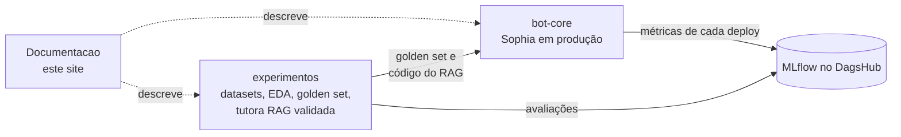

# Entrega final

Mapa de onde está cada item pedido na entrega.

| Item | Onde está |
|---|---|
| Datasets | [Datasets e EDA](datasets-e-eda.md) e pasta `data/` do [experimentos](https://github.com/Challenge-1-Residencia-IA/experimentos) (versionada com DVC no DagsHub) |
| Requisitos funcionais e não funcionais | [Requisitos](requisitos.md), [Levantamento de requisitos](levantamento-de-requisitos.md) e [Histórias de usuário](historias-de-usuario.md) |
| Análise exploratória dos dados (EDA) | [Datasets e EDA](datasets-e-eda.md) e notebooks 01 a 03 do [experimentos](https://github.com/Challenge-1-Residencia-IA/experimentos/tree/main/notebooks) |
| Guiding Questions | [Guiding Questions](guiding-questions.md) |
| Organização/Scrum e papéis | [Organização e Scrum](organizacao-scrum.md) e [Roadmap](roadmap.md) |
| Modelo de IA + relatório técnico | Não treinamos um modelo próprio: usamos o Qwen 2.5 7B com RAG, prompts e guardrails. [Relatório técnico da solução de IA](relatorio-tecnico-modelo.md), [CI/CD e LLMOps](mlops-llmops.md) e o [experimentos](https://github.com/Challenge-1-Residencia-IA/experimentos) |
| Descrição final do produto | [Produto final](produto-final.md) |
| Código e README | [bot-core](https://github.com/Challenge-1-Residencia-IA/bot-core) (aplicação), [experimentos](https://github.com/Challenge-1-Residencia-IA/experimentos) (dados, EDA e avaliação), [Documentacao](https://github.com/Challenge-1-Residencia-IA/Documentacao) (este site) |

## Os três repositórios

- **experimentos**: onde os dados foram estudados e a solução de IA (Qwen + RAG + guardrails) foi montada e validada.
- **bot-core**: a Sophia em produção, com CI/CD e portão de qualidade.
- **Documentacao**: produto, requisitos, arquitetura e relatórios.
