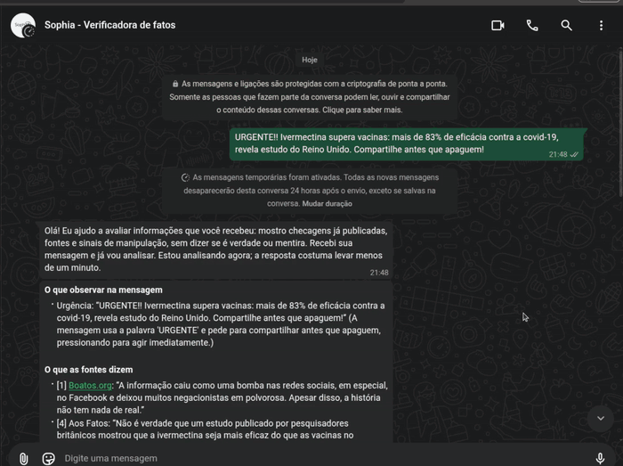

# Sophia — Verificadora de fatos

{ .logo-inicial }

A **Sophia** é uma assistente de WhatsApp que ajuda as pessoas a avaliar mensagens antes de acreditar nelas ou repassá-las. Ela identifica a afirmação principal, busca checagens já publicadas por agências e fontes na internet, cita trechos literais dessas fontes e aponta técnicas de manipulação. **A Sophia não diz se algo é verdadeiro ou falso**: a decisão continua com quem pergunta.

!!! quote "Questão norteadora"
    Como um sistema de IA pode ajudar as pessoas a avaliar a confiabilidade de informações sem substituir seu pensamento crítico?

{ width="560" loading=lazy }

*A Sophia analisando um boato de saúde no WhatsApp.*

## Comece por aqui

| | |
|---|---|
| [Entrega final](entrega-final.md) | Onde está cada item da entrega: datasets, requisitos, EDA, solução de IA, código |
| [Produto final](produto-final.md) | O que a Sophia faz hoje, como funciona e quais são os limites |
| [Arquitetura](arquitetura.md) | Componentes em produção, com diagramas |
| [CI/CD e LLMOps](mlops-llmops.md) | Como uma mudança chega à produção com segurança |

## Repositórios

| Repositório | Conteúdo |
|---|---|
| [bot-core](https://github.com/Challenge-1-Residencia-IA/bot-core) | Aplicação em produção: conector de WhatsApp, núcleo com LangGraph, RAG, guardrails, deploy |
| [experimentos](https://github.com/Challenge-1-Residencia-IA/experimentos) | Datasets (DVC), EDA, golden set, tutora RAG validada e avaliação |
| [Documentacao](https://github.com/Challenge-1-Residencia-IA/Documentacao) | Este site |

Projeto do **Challenge 1 da Residência em IA**, desenvolvido por Felipe Rodrigues, Filipe Lacerda, Larissa Giffoni e Ranni Heler.
