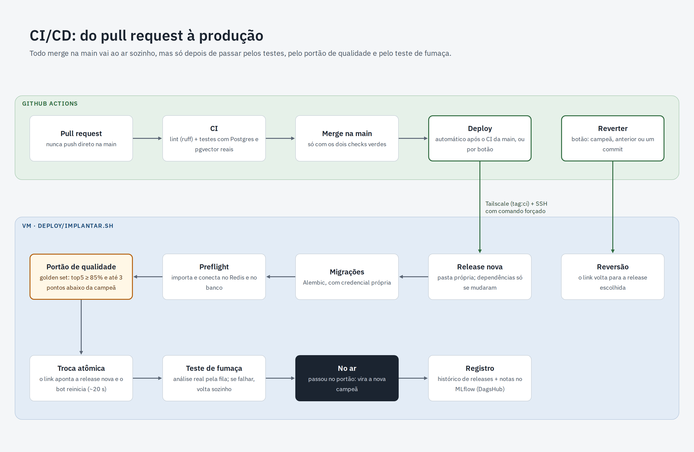
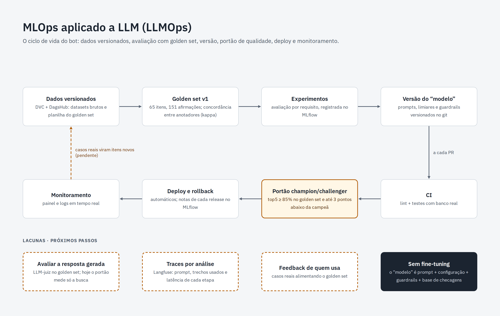

# CI/CD e LLMOps

## Do pull request à produção

1. **CI em todo pull request:** lint (ruff) e testes automatizados com Postgres + pgvector. A `main` é protegida: sem CI verde, não há merge.
2. **Deploy automático no merge:** o GitHub Actions entra na rede privada (Tailscale) e aciona, por SSH com comando restrito, o script de deploy na VM.
3. **Na VM**, cada versão vira uma pasta própria (release). O deploy roda as migrações do banco, um preflight, o **portão de qualidade**, a troca atômica da versão ativa e um teste de fumaça com uma análise de verdade.
4. **Rollback:** qualquer falha devolve a versão anterior automaticamente. Também há um botão "Reverter" para voltar à versão anterior ou à campeã.

## LLMOps: o ciclo da solução de IA

Não treinamos nenhum modelo. O que versionamos é o conjunto **prompt + configuração + guardrails + base de checagens**, sobre um LLM aberto usado como está.

| Prática | Como está implementada |
|---|---|
| Versionamento de dados | DVC com armazenamento no DagsHub (datasets, planilha de anotação, golden set) |
| Versionamento da solução (prompt + configuração) | Prompts e configuração no git; cada release é um commit |
| Avaliação | Golden set v1: 65 boatos reais anotados pelo time |
| Portão champion/challenger | A cada deploy, a busca é avaliada no golden set. A versão nova só fica no ar com **top5 ≥ 85%** e **no máximo 3 pontos abaixo da campeã**, reavaliada no mesmo banco |
| Registro | Cada deploy gera um run no **MLflow** (DagsHub) com top1, top5, ruído e tempo, e indica a versão campeã |
| Rollback | Automático em falha, ou manual pelo botão "Reverter" |

**Resultado atual:** checagem certa em 1º lugar em 78% do golden set e entre as 5 primeiras em 89%.

## Lacunas conhecidas

- **Avaliação da resposta gerada:** o portão mede a busca. A qualidade do texto do LLM foi avaliada na validação da tutora RAG, mas não a cada deploy. Próximo passo: um **LLM-juiz** no portão.
- **Observabilidade em produção:** hoje há logs e um painel ao vivo. Próximo passo: traces por análise com **Langfuse**.
- **Ciclo de feedback:** o usuário ainda não avalia a resposta, e casos reais ainda não viram itens novos do golden set.
- **Versão do LLM:** o Qwen roda fora do pipeline de deploy, então a versão do modelo base não é controlada pelo deploy.
