# Produto final

## O que é

A **Sophia — Verificadora de fatos** é um contato de WhatsApp. A pessoa encaminha uma mensagem suspeita e recebe, em cerca de meio minuto:

- **técnicas de manipulação** encontradas no texto (urgência, pedido de compartilhamento, autoridade sem nome, apelo emocional);
- **o que as fontes dizem**, com trechos copiados literalmente de checagens e reportagens;
- **como verificar por conta própria** (leitura lateral: abrir outras fontes antes de acreditar);
- **as fontes**, com link e data da checagem mais recente.

A Sophia **nunca dá veredito** de verdadeiro ou falso. Ela funciona como uma tutora: mostra o caminho e as evidências, e a decisão fica com o usuário.

## A Sophia em ação

Gravações reais da conversa com a Sophia no WhatsApp (respostas aceleradas).

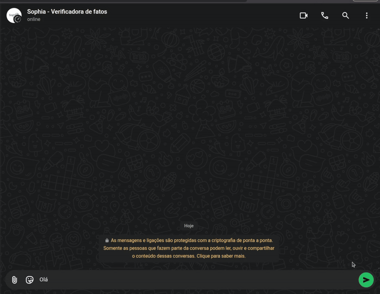{ width="560" loading=lazy }

*Primeiro contato: a Sophia explica o que faz.*

{ width="560" loading=lazy }

*Boato de saúde: técnicas de manipulação, checagens citadas, aviso de saúde e nenhum veredito.*

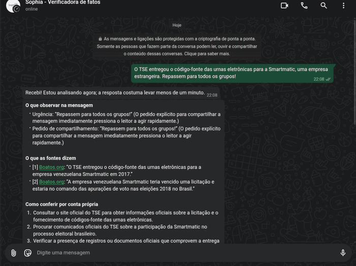{ width="560" loading=lazy }

*Boato eleitoral: checagens do Boatos.org e da Lupa e o caminho para conferir no site do TSE.*

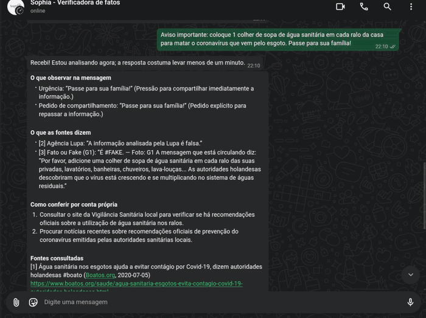{ width="560" loading=lazy }

*Receita caseira perigosa: aviso de saúde e aviso de que a checagem mais recente é antiga.*

## Como funciona

1. O **conector de WhatsApp** (Playwright, numa VM na Oracle Cloud) lê a mensagem e coloca o pedido numa **fila** (Redis + ARQ).
2. O **núcleo** (worker com LangGraph) executa as etapas: guardrail de entrada → extração da afirmação (LLM) → busca → síntese (LLM) → guardrail de saída.
3. A **busca** consulta primeiro a base própria de checagens (Postgres + pgvector no Neon), com busca híbrida semântica e textual. Se a base não tiver nada relevante, ou se a checagem mais recente tiver mais de 6 meses, a busca complementa com a internet, priorizando agências de checagem.
4. O **LLM** é o Qwen 2.5 7B, rodando no Ollama em máquinas da equipe, ligadas à VM por uma rede privada (Tailscale). Se a máquina principal não responder, uma máquina reserva assume.
5. A resposta volta pela fila e o conector a envia no WhatsApp.

## Proteções

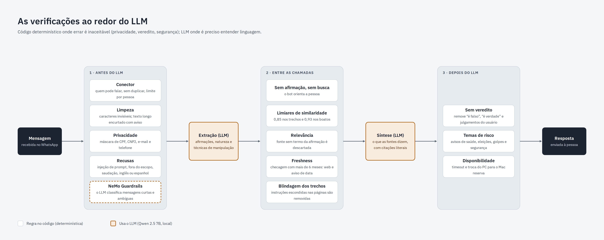

- **Antes do LLM:** recusa de tentativas de manipular o bot (prompt injection), de pedidos fora do escopo e de mensagens em inglês ou espanhol; remoção de caracteres invisíveis; máscara de CPF, CNPJ, e-mail e telefone; mensagens muito longas são truncadas com aviso.
- **Durante:** os trechos das fontes entram no prompt como dados, nunca como instruções. Citações que não existem literalmente na fonte são descartadas.
- **Depois do LLM:** remoção de qualquer veredito ou julgamento do usuário; aviso extra em temas de risco (saúde, eleições, golpes, segurança); aviso de data quando a checagem é antiga.
- **Na operação:** até 10 conversas atendidas ao mesmo tempo, com fila de espera; limite de mensagens pendentes por pessoa; números guardados só como hash.

### Proteções em ação

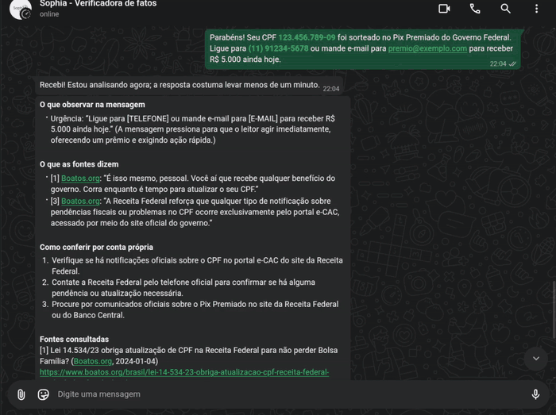{ width="560" loading=lazy }

*Golpe: CPF, telefone e e-mail ocultados antes da pesquisa, com aviso de golpe.*

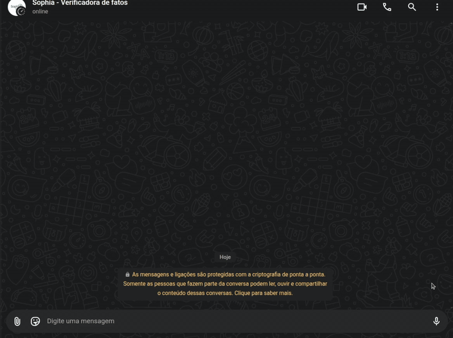{ width="560" loading=lazy }

*Tentativa de mudar as instruções do bot: recusada.*

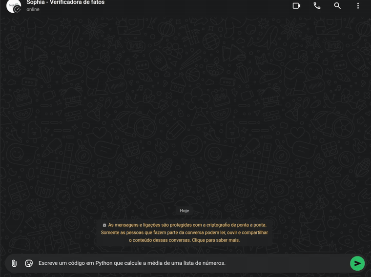{ width="560" loading=lazy }

*Pedido fora do escopo: recusa com orientação de uso.*

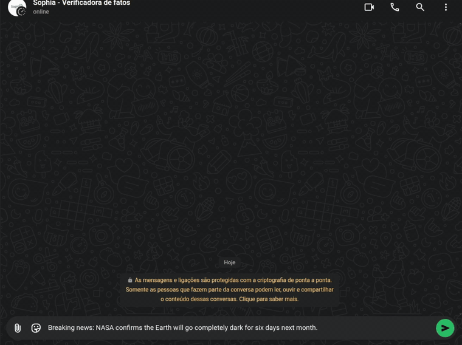{ width="560" loading=lazy }

*Mensagem em outro idioma: por enquanto, só português.*

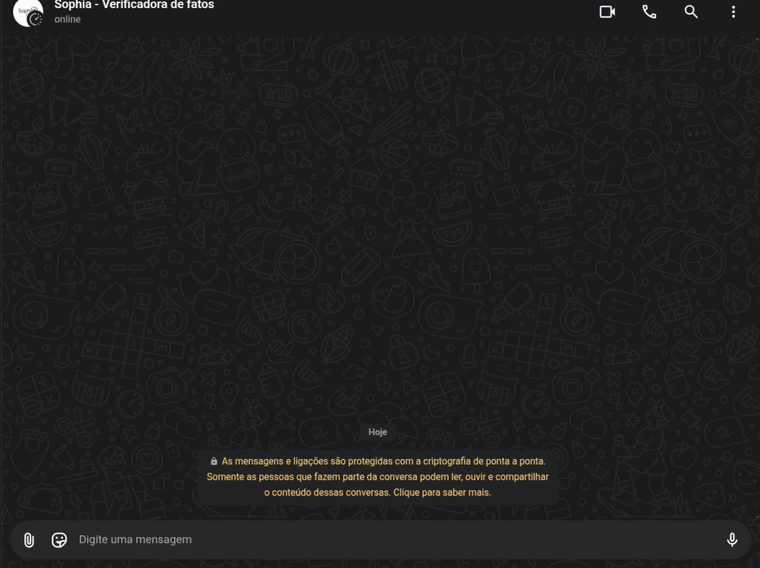{ width="560" loading=lazy }

*Opinião: não há o que verificar, então a Sophia não pesquisa.*

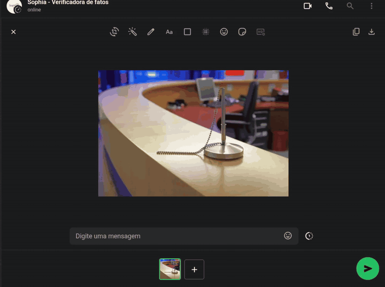{ width="560" loading=lazy }

*Foto sem texto: por enquanto, a Sophia analisa só texto.*

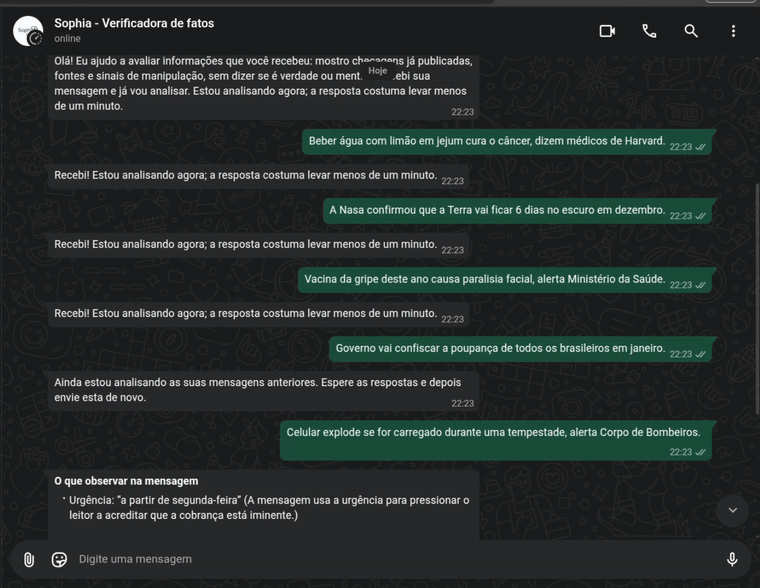{ width="560" loading=lazy }

*Várias mensagens seguidas: as primeiras entram na fila e a excedente recebe aviso para reenviar depois.*

## Resultados

| Indicador | Resultado |
|---|---|
| Checagem certa em 1º lugar na busca (golden set, 65 boatos) | 78% |
| Checagem certa entre as 5 primeiras | 89% (portão de deploy exige ≥ 85%) |
| Respostas sem veredito (validação da tutora RAG) | 100% |
| Mensagens legítimas recusadas pelos guardrails | 0 de 75 |
| Tempo por análise | cerca de 20 a 35 s |

Detalhes em [Relatório técnico da solução de IA](relatorio-tecnico-modelo.md) e [CI/CD e LLMOps](mlops-llmops.md).

## Limitações conhecidas

- **Qualidade da resposta gerada não é medida automaticamente.** O portão de deploy avalia a busca; a resposta do LLM foi avaliada uma vez, na validação da tutora RAG.
- **Base de checagens congelada em 14/10/2026**, por limite de armazenamento do plano gratuito. Casos mais novos dependem da busca na internet.
- **Sem memória de conversa.** Cada mensagem é analisada isoladamente; perguntas de continuação ("e essa outra parte?") ainda não são entendidas.
- **Só texto e links.** Áudio, imagem e vídeo estão fora do escopo do MVP.
- **WhatsApp Web automatizado**, adequado para o MVP. Em escala, o caminho é a API oficial do WhatsApp Business.
- **LLM em máquinas da equipe.** A disponibilidade depende delas estarem ligadas (há failover entre duas).
